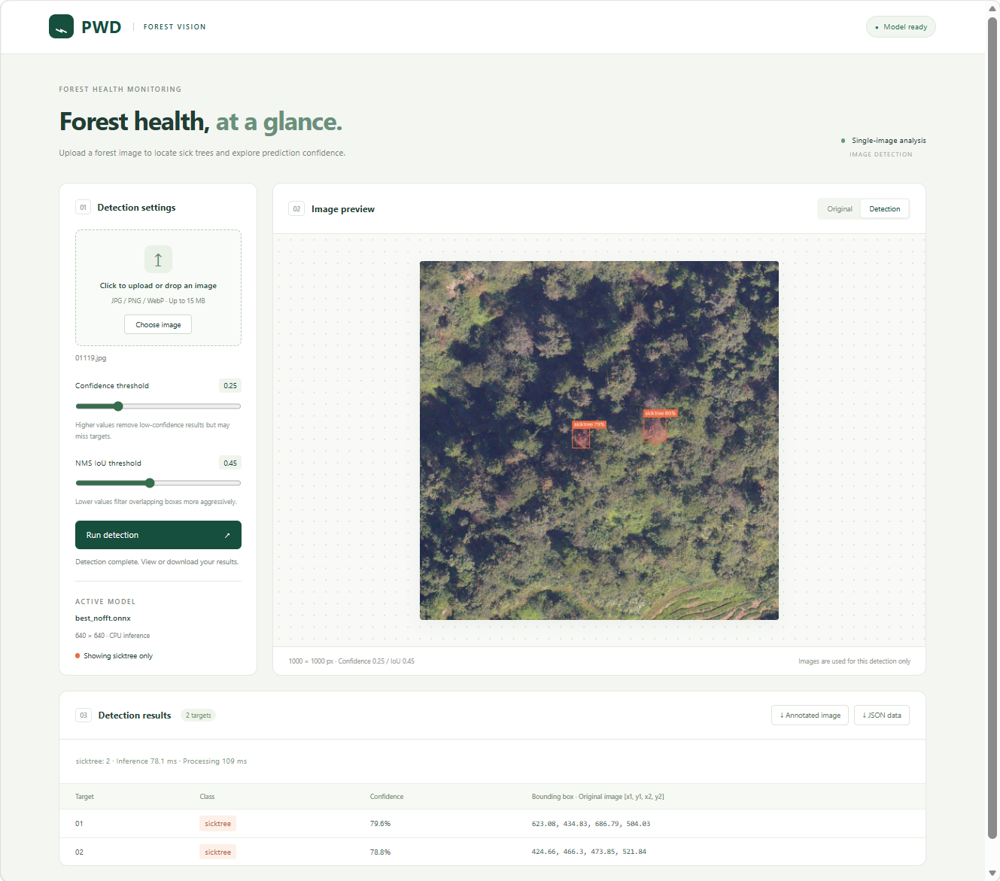

# PWD Web Image Detection

An image detection application built with FastAPI and ONNX Runtime that loads `best_nofft.onnx` directly. Features include image uploads, adjustable confidence and IoU thresholds, switching between original and annotated images, and downloading annotated images and JSON results. Only `sicktree` detections are displayed and returned; `notree` detections are filtered out. Uploaded images and results are processed in memory and are not saved to disk.



## Getting started (Windows PowerShell, Python 3.11)

```powershell
cd E:\projects\projects\web-pwd
python -m venv .venv
.\.venv\Scripts\python.exe -m pip install -r requirements.txt
.\start.ps1
```

Open the [application](http://127.0.0.1:8000) in your browser. Interactive [API documentation](http://127.0.0.1:8000/docs) is also available. Press Ctrl+C in the terminal to stop the server.

If PowerShell blocks script execution, start the server directly:

```powershell
.\.venv\Scripts\python.exe -m uvicorn app:app --host 127.0.0.1 --port 8000 --workers 1
```

## Model configuration

Update `model_path` in `config.json`, or set the `MODEL_PATH` environment variable, then restart the server. The model remains in its original directory and has not been copied into this project. The current model accepts float32 input with shape `[1,3,640,640]` and produces output with shape `[1,6,8400]`. Its classes are `{0: notree, 1: sicktree}`. Original class names are preserved without assigning additional meanings; only `sicktree` is included in detection results.

The inference pipeline uses RGB input normalized by dividing pixel values by 255, centered letterbox padding, YOLO xywh decoding, class-aware non-maximum suppression (NMS), and coordinate mapping back to the original image. Resizing uses Pillow bilinear interpolation, which may produce small differences compared with OpenCV resizing in the training project. Validate detection accuracy against the original pipeline on a labeled validation set before production use.

The application currently runs CPU inference in a single process and handles one image at a time. Requests received while detection is busy return HTTP 429. Each worker process loads its own model instance, so evaluate resource usage before increasing the worker count. Supported formats are JPG, PNG, and WebP, with limits of 15 MB and 25 megapixels per image. For images with EXIF orientation metadata, returned coordinates refer to the orientation-corrected image.

## API endpoints

- `GET /api/health`: Returns model readiness, classes, input dimensions, and the execution provider.
- `POST /api/detect`: Accepts multipart fields `file`, `confidence` (default: 0.25), and `iou` (default: 0.45). Returns `detections` containing class IDs, class names, confidence scores, and xyxy coordinates, along with original image dimensions, inference and processing times, and an annotated JPEG data URL.

## Testing

```powershell
.\.venv\Scripts\python.exe -m pip install httpx
.\.venv\Scripts\python.exe -m unittest discover -s tests -v
```

Tests cover actual ONNX model inference and API error handling. Synthetic images verify that the inference pipeline works; they do not measure detection accuracy.

## Deployment

This version is a local prototype without authentication or public hosting. For deployment, place the Python service and model on a server, configure HTTPS and authentication, and enforce upload size limits at the reverse proxy. Publishing the static frontend alone cannot run this local model.
